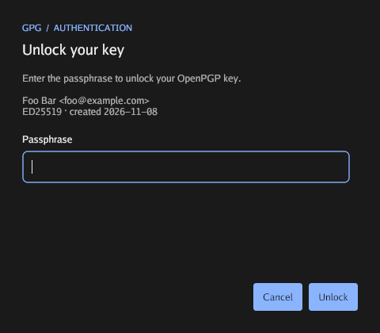
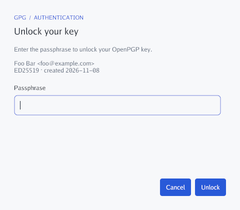

# pinentry-gio

A small Linux GPG pinentry written in Go and [Gio](https://gioui.org).
It speaks the [Assuan pinentry protocol](https://www.gnupg.org/documentation/manuals/assuan/)
directly over stdin/stdout; it does not require libassuan.

## Screenshots

| Dark theme | Light theme |
| --- | --- |
|  |  |

## Build and preview

Requires Go 1.24 or newer, a C compiler, pkg-config, and Gio's Linux development
dependencies. On Debian/Ubuntu:

```sh
sudo apt install build-essential pkg-config libwayland-dev libx11-dev \
  libx11-xcb-dev libxkbcommon-x11-dev libegl1-mesa-dev libgles2-mesa-dev \
  libffi-dev libxcursor-dev libvulkan-dev
```

```sh
go build -tags novulkan -o pinentry-gio .
./pinentry-gio --demo # test
```
